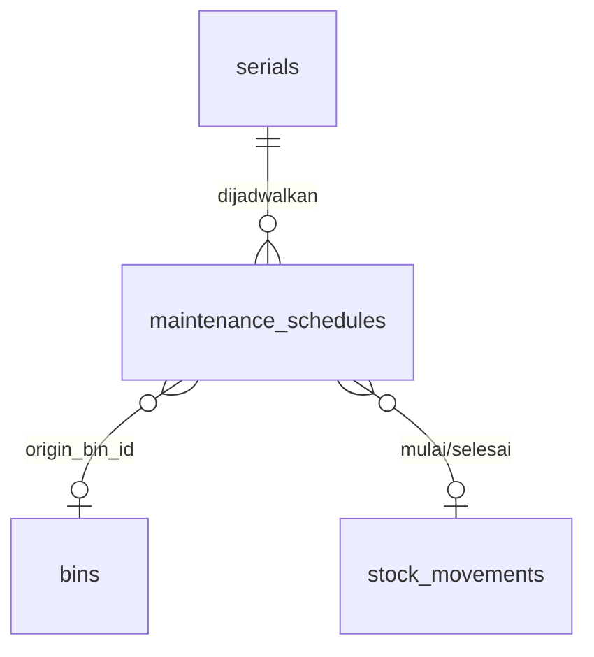

# Spesifikasi Modul — Pendukung Fase 2 (Tahap 1)

**Versi:** 0.1
**Tanggal:** 3 November 2026
**Status:** disetujui arahnya (3 Nov 2026); angka bawaan *Perlu validasi* ([A-427](04c-asumsi-lanjutan.md#a-427))
**Modul:** lintas modul: `asset` (jadwal servis), `count` (cycle count ABC), `access` (auditor eksternal berbatas waktu)
**Fase:** F2 (tahap 1 rencana kerja Fase 2b, [D-29](04-keputusan-dan-asumsi.md#d-29)); PWA offline penuh di [32-pwa-offline](32-pwa-offline.md)
**Dokumen terkait:** [Blueprint §6.8, §9, §4](01-blueprint.md) · [BR-AST-01, BR-AST-07, BR-OPN-01, BR-OPN-11, BR-ACC-01, BR-ACC-07](05-aturan-bisnis.md) · [25-aset](25-aset.md) · [21-opname-penyesuaian](21-opname-penyesuaian.md) · [10-access](10-access.md) · [A-423](04c-asumsi-lanjutan.md#a-423)–[A-427](04c-asumsi-lanjutan.md#a-427)
**Ketergantungan modul:** Asset, Count, Access, Stock (StockLedger), Warehouse (bin Karantina)

---

## 1. Tujuan & lingkup

Tiga fitur Fase 2 yang kerangkanya sudah ada di Fase 1 (tabel stub, enum bertag `[F2]`, kolom `valid_until`), dibangun lebih dulu karena risikonya rendah:

1. **Jadwal servis aset** `[F2]` ([A-423](04c-asumsi-lanjutan.md#a-423)): aset dijadwalkan servis berkala atau otomatis dari skor pemeriksaan rendah; *Mulai servis* memindah aset ke bin Karantina lewat kartu stok sehingga state-nya `maintenance` dan tidak bisa dicadangkan; *Selesai servis* mengembalikannya ke bin penyimpanan.
2. **Cycle count ABC** `[F2]` ([A-424](04c-asumsi-lanjutan.md#a-424)): item digolongkan A/B/C menurut **frekuensi mutasi** (bukan nilai uang, [D-07](04-keputusan-dan-asumsi.md#d-07)); sesi `cycle_abc` untuk satu gudang berisi item yang jatuh tempo hitung, lalu memakai mesin opname yang ada (bekukan, hitung buta, hitung ulang, approval, ADJ).
3. **Auditor eksternal berbatas waktu** `[F2]` ([A-425](04c-asumsi-lanjutan.md#a-425)): role *Auditor Eksternal* wajib dibatasi gudang **dan** tanggal akhir akses; lewat tanggal itu akses berhenti, termasuk sesi yang sedang berjalan.

Tidak termasuk: pemicu servis dari meter/jam pakai (menunggu data meter yang rapi, [A-427](04c-asumsi-lanjutan.md#a-427)); biaya servis (D-07); jadwal opname ABC otomatis tanpa dibuat orang (sesi tetap dibuat Kepala Gudang); undangan auditor lewat tautan tanpa akun.

## 2. Aktor & permission

| Role | Permission | Cakupan |
|---|---|---|
| Kepala Gudang, Staf Gudang | `asset.maintain` *(baru)*: rencanakan, mulai, selesaikan servis | gudang tempat aset berada |
| Kepala Gudang, Auditor Internal | `count.create` (jenis `cycle_abc` ikut) | gudang yang ditugaskan |
| Admin Company | `role.assign`: memberi role Auditor Eksternal beserta tanggal akhir | semua |
| Auditor Eksternal | izin role bawaan tidak berubah (`count.view`, `count.record`, `adjustment.view`, lihat dokumen) | gudang yang ditugaskan, sampai tanggal akhir |

`asset.maintain` dipasang ke company yang sudah ada lewat migrasi tenant yang **menambah** baris izin ke role bawaan Kepala/Staf Gudang/Admin Company tanpa `sync` (pengubahan role oleh Admin Company tidak tertimpa).

## 3. Entitas & data

### 3.1 `maintenance_schedules` (stub Fase 1, kolom baru)

| Kolom | Tipe | Null | Keterangan |
|---|---|---|---|
| `serial_id` | bigint FK `serials` | — | aset (item `asset`/`both`, serial) |
| `scheduled_at` | date | — | tanggal rencana |
| `interval_days` | int | ya | servis berkala: jadwal berikutnya dibuat saat selesai |
| `status` | varchar | — | `maintenance_status` ([KS §3](06-katalog-status-dan-enum.md#3-enum-lain)): `planned` · `in_progress` · `done` |
| `source` *(baru)* | varchar(20) | — | `manual` · `interval` (dari jadwal sebelumnya) · `inspection` (skor rendah) |
| `origin_bin_id` *(baru)* | bigint FK `bins` | ya | bin penyimpanan sebelum servis; saran bin tujuan saat selesai |
| `started_movement_id`, `finished_movement_id` *(baru)* | bigint FK `stock_movements` | ya | jejak kartu stok |
| `performed_at` | date | ya | tanggal selesai |
| `notes` | varchar(255) | ya | |
| `created_by` *(baru)* | bigint FK `users` | ya | null = dibuat sistem |

Satu aset paling banyak **satu** jadwal terbuka (`planned`/`in_progress`).

### 3.2 Cycle count ABC: tanpa tabel baru

Kelas ABC dihitung saat dibutuhkan (`AbcCyclePlanner`) dari `stock_movements` 90 hari terakhir di gudang itu; tanggal hitung terakhir per item dari `count_lines` sesi `approved`/`closed` gudang itu. Sesi memakai `stock_counts.scope.item_ids` yang sudah ada.

### 3.3 Auditor eksternal: tanpa tabel baru

Memakai `role_assignments.valid_from`/`valid_until` (kolom Fase 1). Pengecualian tercatat dari [A-337](04b-asumsi-lanjutan.md#a-337): hanya peran ini yang memegang tanggal di form pengguna.

## 4. Mesin status

`maintenance_status` (Katalog §3):

| Transisi | Aksi (permission) | Guard | Efek |
|---|---|---|---|
| (baru) → `planned` | `MaintainAsset::plan` (`asset.maintain`) atau sistem (`MaintainAsset::dariPemeriksaan`) | aset bukan `lost`/`written_off`; belum ada jadwal terbuka | activity log |
| `planned` → `planned` | `MaintainAsset::plan` ubah tanggal/interval/catatan | | |
| `planned` → `in_progress` | `MaintainAsset::start` | aset `available` di bin penyimpanan gudang cakupan; tanpa reservasi aktif; gudang punya bin Karantina aktif | `StockLedger::post` bin penyimpanan → bin Karantina (`document_type = maintenance`); `AssetStateSync` → `maintenance` |
| `in_progress` → `done` | `MaintainAsset::finish` | bin tujuan = bin penyimpanan aktif gudang yang sama | `StockLedger::post` Karantina → bin tujuan; state → `available`; bila `interval_days` terisi, jadwal `planned` baru (`source = interval`) pada `performed_at + interval_days` |

## 5. Aturan bisnis yang berlaku

| BR | Catatan implementasi |
|---|---|
| [BR-AST-01](05-aturan-bisnis.md#br-ast) | state tidak ditulis langsung; mengikuti bin lewat `AssetStateSync` |
| [BR-AST-07](05-aturan-bisnis.md#br-ast) | aset di Karantina bukan stok tersedia, jadi tidak bisa dicadangkan; pemicu skor: pemeriksaan dengan skor di bawah ambang membuat jadwal `planned` hari itu (`source = inspection`) bila belum ada jadwal terbuka |
| [BR-OPN-01](05-aturan-bisnis.md#br-opn) | sesi `cycle_abc` mencakup **satu** gudang; item dari perencana; snapshot & pembekuan seperti sesi ad-hoc bercakupan item |
| [BR-OPN-11](05-aturan-bisnis.md#br-opn) *(baru)* | klasifikasi & jatuh tempo ABC, batas item per sesi |
| [BR-ACC-01](05-aturan-bisnis.md#br-acc) | diperketat: diperiksa **setiap request**, bukan hanya saat login |
| [BR-ACC-07](05-aturan-bisnis.md#br-acc) *(baru)* | role Auditor Eksternal wajib cakupan gudang + tanggal akhir |
| P-01 | semua perpindahan aset servis lewat `StockLedger` |

## 6. Layar

### 6.1 Detail aset — `/assets/{serial}` — kartu **Servis**

- Daftar jadwal (tanggal, status, asal, selesai, catatan), terbaru di atas.
- Form *Jadwalkan servis*: Tanggal `*`, Ulangi tiap (hari) opsional, Catatan; tombol ubah pada jadwal `planned`.
- Tombol *Mulai servis* (jadwal `planned`, aset di gudang) dan *Selesai servis* dengan pilihan **Bin tujuan** `*` (bawaan: bin asal).
- Keadaan kosong: "Belum ada jadwal servis untuk aset ini."

### 6.2 Daftar aset — `/assets` — saringan **Servis**

Pilihan *Servis jatuh tempo* (jadwal `planned` dengan tanggal ≤ hari ini) dan *Sedang diservis*. Kartu Beranda *Servis aset jatuh tempo* (pemegang `asset.maintain`) membuka saringan ini.

### 6.3 Form opname — `/counts/create` — jenis **Cycle count ABC**

Memilih jenis ini meminta tepat satu gudang, menyembunyikan isian zona/bin/item, dan menampilkan pratinjau: jumlah item jatuh tempo per kelas (A/B/C) serta daftar item yang akan masuk sesi (maks. batas per sesi, kelas A dulu, lalu paling lama belum dihitung). Tanpa item jatuh tempo: "Tidak ada item yang jatuh tempo hitung di gudang ini." dan tombol simpan nonaktif.

### 6.4 Form pengguna — peran **Auditor Eksternal**

Pertanyaan peran: *Gudang mana?* `*` (centang, seperti Kepala Gudang) dan **Akses sampai** `*` (tanggal, hari ini sampai batas maksimum). Detail pengguna menampilkan "Akses audit sampai {tanggal}". Lewat tanggal itu: login ditolak, dan sesi yang masih terbuka dikeluarkan pada request berikutnya dengan pesan "Masa akses Anda sudah berakhir."

## 7. Kejadian stok & integrasi

| Kejadian | Pemicu | Rujukan |
|---|---|---|
| (tanpa kejadian outbox baru) | pindah bin servis tercatat di kartu stok `document_type = maintenance` | P-01, AD-05 |

## 8. Notifikasi

| Kejadian | Penerima | Kanal |
|---|---|---|
| Kartu Beranda *Servis aset jatuh tempo* | pemegang `asset.maintain` di gudang aset | Beranda |

## 9. Laporan & dashboard

Kartu Beranda di §8. Laporan baru tidak ada; hasil cycle count tampil di laporan Akurasi stok yang sudah ada.

## 10. Kasus uji (Given / When / Then)

| ID | Given | When | Then | BR |
|---|---|---|---|---|
| TC-F2-01 | aset `available` di bin penyimpanan | jadwalkan, mulai, selesai ke bin asal | 2 baris kartu stok `maintenance`; state `maintenance` lalu `available`; jadwal `done` | BR-AST-01, BR-AST-07 |
| TC-F2-02 | jadwal ber-interval 30 hari | selesai | jadwal `planned` baru +30 hari, `source = interval` | BR-AST-07 |
| TC-F2-03 | aset dicadangkan / sedang dipinjam / sudah ada jadwal terbuka | mulai servis / jadwalkan lagi | ditolak dengan pesan | BR-AST-07 |
| TC-F2-04 | aset kembali, diperiksa skor 40 | `asset.inspect` | jadwal `planned` hari ini `source = inspection`; skor 80 tidak membuat jadwal | BR-AST-07 |
| TC-F2-05 | user tanpa `asset.maintain` / gudang di luar cakupan | mulai servis | ditolak | BR-GEN-09 |
| TC-F2-06 | gudang dengan item bermutasi banyak/sedikit/tanpa mutasi | perencana ABC | kelas A/B/C sesuai ambang; item tanpa mutasi = C | BR-OPN-11 |
| TC-F2-07 | item A dihitung 10 hari lalu, item B belum pernah | perencana | A tidak jatuh tempo, B jatuh tempo | BR-OPN-11 |
| TC-F2-08 | 2 gudang dipilih / tanpa item jatuh tempo | buat sesi `cycle_abc` | ditolak | BR-OPN-01, BR-OPN-11 |
| TC-F2-09 | item jatuh tempo ada | buat sesi `cycle_abc` | sesi `planned`, `scope.item_ids` = item perencana (maks. batas) | BR-OPN-11 |
| TC-F2-10 | form pengguna, peran Auditor Eksternal tanpa tanggal / lewat batas maksimum | simpan | ditolak per isian | BR-ACC-07 |
| TC-F2-11 | auditor eksternal sampai kemarin | login | ditolak "belum punya penugasan role yang berlaku" | BR-ACC-01 |
| TC-F2-12 | auditor sedang login, tanggal akhir lewat | request berikutnya | dikeluarkan ke halaman login dengan pesan masa akses berakhir | BR-ACC-01 |

## 11. Di luar lingkup modul ini

PWA offline penuh dan antrean tinjauan ([32-pwa-offline](32-pwa-offline.md)); RFID (menunggu [O-10](04-keputusan-dan-asumsi.md#o-10)); BoQ, resep konversi, editor template (daftar tunggu Fase 2).

## 12. Definisi selesai

- [x] Migrasi kolom `maintenance_schedules` + izin `asset.maintain` untuk company lama (`000570`)
- [x] Aksi `MaintainAsset` (plan/start/finish, satu kelas karena satu izin `asset.maintain`); pemicu skor di `InspectAsset`; kartu Servis `Asset\Livewire\AssetMaintenance`
- [x] `AbcCyclePlanner` + `CountType::CycleAbc` bisa dipilih; pratinjau di form opname
- [x] Peran Auditor Eksternal bertanggal di form pengguna; pemeriksaan masa akses per request (`EnsureInternalArea`/`EnsureClientPortal`, juga untuk aksi Livewire)
- [ ] TC-F2-01–12 lulus; uji browser layar baru (desktop & HP)
- [ ] Katalog, glosarium, aturan bisnis, 25/21/10 diperbarui; versi naik + changelog
